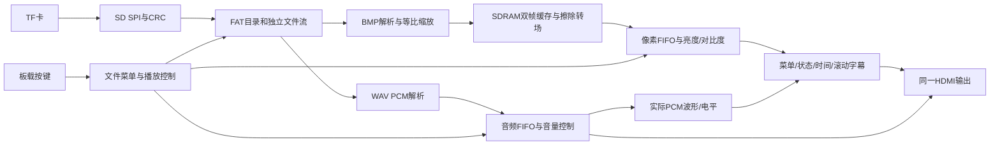

# 2026-11-04 实板验证更新

已加载releases/scaling_demo_20261103配套位流到SRAM，TF卡19张图片和19页新配置已生效。从第0页到第10页第一题的自动连播全程未注入翻页指令，第一题等待人工回答。已验证焦点移动、前后翻页、返回、KEY2独立暂停/恢复轮播、空答案拦截、答案修改/锁定、防重复计分、三题2/3结果及重新学习清零、菜单阻止自动跳页、音量0～8与静音、通知/优先通知退出恢复、三种音源选择和重播动作。最终停在第一题，分数0，未选择答案，轮播开启、音频未暂停。

操作通过UART注入与按键共用的UI动作/控制路径；未代替实体按键按压或屏幕/扬声器的现场观察。亮度/对比度确认了设置命令响应，精确数值和画面变化不在精简遥测中。KEY13重播页面默认音轨；在音源按钮上重复确认请求重播该音源。Flash未写。

证据：docs/scaling_controls_board_summary.json及三个分段记录。测试中两处脚本预期已依据现有规格修正（音量上限8；KEY13为页面默认音轨），对应功能随后通过；原始记录保留。

---

# 最新生成版本：三张缩放演示图＋开机自动连播（2026-11-03）

主工程位于当前工作空间，桌面工程仅作参考。新配置19页，以横图、竖图、小图为前三页，开机自动连播到第一道题并等待人工作答；KEY2仅暂停/恢复轮播。顶部中文字幕继续保留。已通过实际配置运行时仿真、三种尺寸逐像素缩放验证及最终STA（setup +0.102ns、hold +0.075ns）。配套文件在releases/scaling_demo_20261103；TF_UPDATE仅4个文件，新位流为同目录dmz_track1.bit。本轮未下载到板卡、未更新实卡、未写Flash；联合实板验证待文件更新后进行。详见docs/SCALING_DEMO.md和docs/scaling_demo_validation.json。

以下是历史版本记录。

---

# 最新版本：顶部中文循环字幕（2026-11-03）

已将指定项目说明置于屏幕最上方，白字深蓝底，向左循环滚动，末尾18个全角空格；原底部英文滚动字幕已移除。TF卡无需更新。最终时序通过（setup +0.033ns、hold +0.076ns），已下载SRAM；自动推进、KEY2仅暂停/恢复轮播、答题等待的板端回归通过。尚未写Flash；实际屏幕文字观感待用户确认。

版本文件：releases/top_ticker_20261103/dmz_track1.bit。验证：docs/top_ticker_validation.json。设计与滚动速度：docs/SUBTITLE_DESIGN.md。以下为历史版本记录。

---

# 最新版本：宽屏常驻面板＋波形触发与课件连播（2026-11-03）

本条优先于下方历史记录。当前连播优化版已通过最终STA（setup +0.177ns、hold +0.067ns）并下载SRAM。新TF配置已生效，板端自动推进、KEY2只暂停/恢复轮播而音频继续、题目等待作答均通过。归档releases/course_autoplay_20261103，证据docs/course_autoplay_validation.json。触发基线观察已获用户确认，记录见docs/trigger_validation.json。未写Flash。

- 输出1280×720、75MHz像素时钟，约60.606Hz；中央课件等比显示，右侧参数栏每页常驻。
- 声音观察页默认TRIG ON；KEY4（第三排最右）切换ON/OFF，左侧提示同步变化。其他页面KEY4保留通知退出语义。KEY10重播所选音源。
- 音频FIFO和BMP行缓存已映射32Kb RAM。最终物理资源17106 LUT（87.28%）、9306 REG、52/64 BRAM9K、3/16 BRAM32K、21 DSP、2 PLL。每块32Kb为4KB。
- 软件验证覆盖触发重复捕获/静音AUTO、连续细线栅格、真实SDRAM两帧取图与媒体切换；正式归档 releases/trigger_stable_20261103。
- 课件默认手动；KEY2启动或暂停/恢复自动翻页，只控制轮播，音频继续播放。讲解音频按实际完成事件推进，答题页等待人工选择；继续复用已有水平擦除。
- 课件TF更新只需替换根目录SCENE.BIN，媒体文件不用重拷。需下载本轮重新构建的FPGA位流；未写Flash。字幕与解析播报仍待后续。
- 触发/验收说明 docs/WAVE_TRIGGER.md；连播说明 docs/COURSE_AUTOPLAY.md；字幕设计 docs/SUBTITLE_DESIGN.md。

---

# 当前版本：宽屏与每页常驻状态栏（2026-11-03）

1280×720、约60.606Hz；已完成最终STA（setup +0.130ns / hold +0.037ns）并下载SRAM。中央等比课件、右侧常驻参数栏；波形触发稳定尚待后续实现。约30Hz旧候选现场黑屏，已弃用。当前归档 releases/widescreen60_persistent_20261103；说明 docs/WIDESCREEN.md；证据 docs/widescreen_validation.json。以下早期版本记录以本条及当前宽屏说明为准。

# 当前版本：1280×720宽屏（2026-11-03）

已通过最终布线与STA：setup +0.178ns、hold +0.103ns；已下载SRAM。约30.303帧/秒自定义时序（37.5MHz像素），不是720p60。中央960×720等比课件，右侧黑边内128×320状态栏。板端课件/通知/三种音源切换检查通过；现场观察验收待用户回复。说明：docs/WIDESCREEN.md，证据：docs/widescreen_validation.json、docs/widescreen_board_observation.json；归档：releases/widescreen_20261103。Flash未写。下文旧版本描述以此条及宽屏说明为准。

# DMZ FPGA 多媒体展示系统

## 2026-11-02 右侧状态/参数面板（当前SRAM，已验收）

用户调整顺序，先完成状态小界面与赛题扩展(4)。观察页右侧(576,128)、64×160中文面板显示播放/暂停/静音/结束/加载/无声/错误、音量、亮度及对比度；设置菜单打开时也显示，通知及应急隐藏。参数改变后，数值和方向箭头高亮约2秒，带刻度条。采用实际显示参数，不改变音量增益或音频采样。用户确认“文字清晰，播放和各状态均正常”“调节、数值、变化提示及恢复默认均正常”。

已下载COM3，16页与媒体错误0；建立余量+1.792ns、保持余量+0.030ns，LUT16553、REG8888、BRAM64/64、DSP20，seed7。位流d1eec884b32a5521e14e3946f1e8972da5bf857967441fedc7958adf79fd043f。122880像素状态/参数/边界回归通过。证据docs/STATUS_PARAMETER_PANEL.md、docs/status_panel_validation.json。最终音量5/8（用户操作），非静音/非暂停，菜单关闭；不要擅自恢复音量。未写Flash。

峰形V3与大显示框保留。触发稳定及左侧按钮仍未实现，必须另行询问、获得用户执行指令才开发。BRAM已满，后续优先复用既有字库和SCENE图层，不增独立字库。下方较早的执行顺序/位流/时序为历史。


## 2026-11-02 波形峰形与连续性V3（当前SRAM，已验收）

用户确认“峰形改善、声音正常，本项合格”。显示框仍512×160、位置(64,128)，显示采样3k→6kHz，128点约21.3ms，保留12位幅度至插值后再换算像素。73728满幅/边界像素及73728真实TONE01像素校验通过；最终setup +0.630ns、hold +0.030ns，LUT16603、BRAM63、DSP20，布局seed7。已下载COM3，16页/16BMP/7WAV，错误0。位流1cb47619a95d7bec2105c59780d03ded79d0a28a2cf512e8f4d5bd12178c1123。音量/实际音频不变，未写Flash。

用户要求严格逐项执行：峰形任务已合格；下一步必须先询问是否实现触发稳定及左侧控制按钮，获得指令后才开发；右侧状态界面必须等触发任务合格后再询问。当前未实现触发锁定和状态界面，起点仍可能漂移。证据见docs/WAVE_PEAK_V3.md、docs/wave_peak_v3_validation.json。

下方V2/V1及更早位流、时序、待办为历史，当前阶段以上方说明为准。


## 2026-11-02 放大波形观察版V2（当前SRAM）

经用户同意，显示框固定为(64,128)、512×160；波形满幅约128像素，取消旧±22显示限幅，采用半开线段减少交接点重复像素。忽略背景图及SCENE旧波形坐标，保留音源按钮布局、音量、采样及课件/高亮功能。73728像素绘制与PCM/控制回归通过，setup +1.829ns、hold +0.086ns，LUT16250、BRAM62、DSP20，布局seed6。已下载COM3板卡并进入观察页，错误0；新版观感待用户反馈，未写Flash。位流65ca8b7ea17e0925cfae19ce129e4ecc35815be2b80f5f6ed8f9a3a369dbedcc。说明与证据：docs/WAVE_ENLARGED_V2.md、docs/wave_enlarged_v2_validation.json。

下方波形V1和更早位流/时序为历史。V1用户反馈声音正常、整体改善，但纯音峰值有像素堆叠，已记录在V1验收文件。


## 2026-11-02 波形连续细化第一版（当前SRAM）

相邻采样点连线、浅斜率1像素细线及陡变连续连接已接入唯一主工程。保持原显示框位置/512×64大小、增益、采样和电平条；答题高亮与10步擦除沿用此前改动。24576像素绘制校验通过，最终setup +0.108ns、hold +0.023ns，LUT16244、BRAM62，已下载COM3对应板卡并进入观察页，错误为0。位流b6477a0475c89544b7ee975eda69f1c28bb0fcca7e0253c5aa62189182da7330。用户观察待反馈；必须在观察后再咨询是否放大，不得提前放大。说明及证据见docs/WAVE_LINE_V1.md、docs/wave_line_v1_validation.json。未写Flash。

下方交互版及更早时序/位流为历史记录。


## 2026-11-02 交互调整版（当前板卡）

当前SRAM位流SHA256：bd838306db90772a8c426e3d49cb6a1a6186a16caadc6162b1a0b51d8a22b7d2。已下载并确认16页启动、CFG/SD/BMP/WAV错误为0；建立时间余量+1.566ns、保持时间余量+0.105ns。焦点外框与答案内框、10步擦除、波形增益、完整课件和真实素材仿真通过，实物显示效果等待用户反馈。自动测试证据见 docs/platform_interaction_board_validation.json。

KEY2仍负责音频暂停/恢复，也会暂停课件自动跳转计时；图库已有自动轮播控制，课件仅按配置自动跳转，尚未增加独立自动轮播开关。擦除从20步缩短至10步，TF读取和图片合成的实际耗时尚未量化。此版仅SRAM，未写Flash。


## 当前开发版（2026-11-02，已下载SRAM，未固化）

统一主工程已完成本轮实拍问题修正并下载SRAM：蓝色背景恢复、红色警示页恢复、讲解可重复重播，三个音源和实时波形可用，KEY4结束警示与KEY8返回第三讲均已由用户确认。板端16页课件自动流程通过，最终计分2/3，配置/SD/BMP/WAV错误为0。当前时序setup +0.266ns、hold +0.030ns，LUT16089、BRAM62。位流SHA256：25e1fc49f83a81bdd24e7bcb0c524005cb3921b735ecee7b4adb6d472b03cba9。未写Flash。证据见 docs/platform_v2_board_validation.json 和 docs/platform_runtime_validation_boardfix.json。

使用说明及工程结构见[配置交互平台说明](docs/PLATFORM_RUNTIME.md)，键位见[平台按键说明](docs/PLATFORM_KEYS.md)。唯一主工程仍是 build_system/dmz_track1.al。课件素材包在 assets/platform/tf_course_v2，另一套配置在 assets/platform/tf_notice_v2；同一 TF 卡根目录只使用一份 SCENE.BIN。没有有效配置时保留媒体兼容模式。

板卡、COM9、JTAG、HDMI 和新课件 TF 卡现已连接；本轮先完成 SRAM 课件验收，未执行 Flash 擦写。音量继续保留 0～8 档及原增益；最终响度上限受扩展屏音量设置限制。

文档统一入口：[工作区文档导航](docs/DOCUMENT_INDEX.md)。

## 最终目标声明（2026-11-01，优先于下方旧定位）

**基于FPGA的可配置交互多媒体演示平台，以“声音与音色”教学课件展示能力。**

现行要求见[最终目标与实施边界](docs/PROJECT_GOALS_LOCKED.md)。页面、图层、控件及动作通过TF资源和配置组合，在支持范围内更换课件无需重编译FPGA；首套教学模板不限制其他页面布局。三分钟演示视频，完整操作流程可更长。配置化平台、按钮图层与课程组件已接入主工程并完成软件整合验证；本批硬件验收尚未完成。Flash固化及断电自动启动已由用户追加为最终交付项（2026-11-01），当前待实现、待实板验收；这是用户工程要求，不是赛题原文的强制条款。

当前配对版已于2026-11-01完成四组索引实板检查，用户反馈“切换较快”；旧文中的“无硬件测试”仅指此前开发阶段，精确同步时差仍未测。

当前配对功能变更及验证边界见[配对播放说明](docs/PAIRED_PLAYBACK.md)。KEY10已增加配对模式切换，下方旧说明以此变更为准；默认背景模式，本次无硬件测试。

完整操作入口：[用户使用说明（含安路TD软件、下载、按键与常见问题）](USER_GUIDE.md)。

## 当前范围裁定（2026-10-28，用户最新指示）

用户明确要求：“满足赛题一明确要求即可。”本节优先于下文所有历史计划中“必须非易失启动”“下一步P8固化”等表述。

- 以用户提供的赛题一1.2～1.6为验收依据：指定FPGA平台、明确多媒体应用场景、所有算法/控制/数据处理在FPGA实现、外围无额外处理器，以及核心功能、显示稳定性、基础音频和工程规范性。
- Flash固化、掉电后自动冷启动不是所提供赛题的明确必做项，移出必做范围；不自动推进P8固化或追加完整脱机冷启动验收。当前仅SRAM下载，断电配置丢失，重新上电需下载，不能宣称已固化。
- 下载后媒体读取、解析、播放和板载交互均由FPGA完成；电脑可供电，开发时可用于下载/诊断，不参与运行时算法处理。
- 五项扩展属于可选加分项，当前已集成并实物确认字幕/图层、转场、缩放、参数调节与OSD、实际PCM可视化；保留成果，无需另设新增门槛。应急模式也已实物确认。
- 当前同一主工程作为交付基线。只在出现相关故障或明确新增需求时继续修改和针对性验证，不重复无关基础测试。已有证据表明功能覆盖所提供要求，最终竞赛评定由评委决定。


**最新P7：已集成实际输出PCM波形/左右电平与A11应急模式，程序及用户屏幕/拨码实物确认均通过；证据见docs/p7_validation.json。操作见[可视化与应急说明](docs/P7_VISUAL_EMERGENCY.md)。**

更新：2026-10-28。硬件：大拇指DMZ_EG4S20 / 安路EG4S20BG256，配套综合底板提供TF与HDMI接口。

当前已在实板完成图片/WAV播放、板载按键、文件菜单、OSD、运行时间、滚动字幕、亮度/对比度、等比缩放和水平擦除转场。最新P6验收：7张图片轮播正常，缩放和方向正确，音频连续，相关错误及欠载为零。证据：[P6验证摘要](docs/p6_validation.json)。

## 统一主工程

所有功能在同一主工程中增量集成，下载一份位流即可同时运行。音频可视化和应急模式也已接入这个主工程。

| 入口 | 路径 | 说明 |
|---|---|---|
| TD主工程 | `build_system/dmz_track1.al` | 当前整机工程 |
| 唯一整机顶层 | `rtl/system/dmz_track1_top.sv` | 连接时钟、存储、音画、控制和显示 |
| 当前位流 | `build_system/dmz_track1_Runs/phy_1/dmz_track1.bit` | 整机配置文件 |
| 构建入口 | `scripts/build_system.ps1` | 综合、布局布线、生成位流并检查时序 |
| 下载入口 | `scripts/download_system.ps1` | 下载到FPGA SRAM |
| 控制入口 | `scripts/project.ps1` | 开发阶段构建、下载、诊断与控制 |

`sim/`内的模块测试用于定位问题；历史`build*`目录和`releases/`用于保存早期验证或回退。它们不需要分别下载拼成最终演示，也不是后续功能开发的主入口。

## 目录结构与职责

```text
dmz_track1/
├─ rtl/                         FPGA逻辑源码
│  ├─ system/                   顶层、按键、菜单、媒体控制、OSD及图像参数
│  ├─ media/                    FAT文件服务、BMP缩放、WAV播放与SD仲裁
│  ├─ p3/                       SD SPI接口、双帧缓存与擦除转场
│  ├─ p2/                       SDRAM控制/自检、异步FIFO、状态发送
│  └─ p1/                       HDMI协议、TMDS编码、串行输出与测试音
├─ constraints/                 引脚、电气与时钟约束
├─ build_system/                TD主工程、构建结果和当前整机位流
├─ scripts/                     构建、下载、开发控制与验证脚本
├─ sim/                         模块/集成仿真、存储模型及参考数据
├─ assets/                      素材；p6/为不同尺寸缩放校准BMP
├─ docs/                        结构、需求、操作、进度及验证证据
├─ releases/                    阶段源码/位流/时序/manifest回退归档
├─ README.md                    本说明
└─ README_AI_HANDOFF.md          后续AI接续入口，先读最新章节
```

| 主要源码 | 职责 |
|---|---|
| `rtl/media/dmz_fat_catalog.sv` | 挂载FAT16/32、建立图片/音轨索引、查询文件名 |
| `rtl/media/dmz_fat_stream.sv` | 按簇链提供独立文件字节流，处理反压与取消 |
| `rtl/media/dmz_sd_arbiter.sv` | 共享SD主机，音频缓冲低水位时优先供数 |
| `rtl/media/dmz_bmp_decoder.sv`、`dmz_udiv32.sv` | BMP解析、行缓存、比例计算与等比最近邻缩放 |
| `rtl/media/dmz_wav_decoder.sv`、`dmz_wav_player.sv` | WAV PCM解析、选轨、循环与安全重启 |
| `rtl/p3/dmz_image_framebuffer.sv` | 完整帧提交、读写仲裁和旧/新帧擦除转场 |
| `rtl/p2/dmz_sdram_ctrl.sv`、`dmz_pixel_fifo.sv` | SDRAM时序及跨时钟像素/音频/命令缓冲 |
| `rtl/system/dmz_matrix_keys.sv`、`dmz_board_commands.sv` | 矩阵扫描、消抖、按键映射与开发UART仲裁 |
| `rtl/system/dmz_file_menu.sv`、`dmz_gallery_control.sv`、`dmz_media_control.sv` | 文件选择、图片调度、音源/暂停/音量控制 |
| `rtl/system/dmz_display_control.sv`、`dmz_picture_adjust.sv`、`dmz_osd.sv` | 运行时间、亮度/对比度、菜单/状态及滚动字幕叠加 |
| `rtl/p1/hdmi_core/`、`serializer.sv` | HDMI音视频封装、TMDS编码与EG4串行输出 |

## 整机数据流



图片在后台完整加载，显示读取前台；新图就绪才开始擦除，转场结束才交换帧身份，避免覆盖正在显示的内容。缩放仅需一行源图缓存。音频有独立FIFO并优先获得低水位供数，浏览菜单/加载图片/转场不依赖电脑提供素材。OSD实时叠加，不修改原BMP。

输出固定640×480约59.524Hz。像素时钟25MHz、串行125MHz、SDRAM控制50MHz。板内8MiB SDRAM，两帧RGB565的字节基址为0和0x100000，每帧614400字节。HDMI协议核为MIT复用，PLL/SDRAM使用安路器件资源，详见[来源说明](docs/THIRD_PARTY.md)。

## 当前文件与操作范围

- TF卡使用FAT16/32，根目录8.3短文件名；最多32张BMP、16个WAV，按目录顺序索引。
- BMP：宽1～1920、高1～1080，24/32位未压缩BI_RGB；等比最近邻缩放、居中留边，正/负高度均支持。1920×1080上限已逐像素仿真；实卡验证640×480、960×540、241×481和160×120。
- WAV：PCM、48kHz、16位、小端、双声道。默认首个循环，菜单可选择；手动切换音轨从头播放，允许短暂静音。图片切换保持背景音频连续。
- 默认有声自动轮播，音量0～8档。用户要求保留现有音频增益和扩展屏音量设置。
- KEY0/1切图、KEY2暂停/恢复、KEY3静音、KEY4/5音量减/加、KEY6自动、KEY7重扫、KEY11菜单。
- 菜单内：KEY15/14下一/上一项、KEY13分类、KEY12确认。菜单外：KEY15/14亮度加/减、KEY13对比度循环、KEY12恢复4/4。
- 亮度/对比度默认4/4保持原图。UPTIME是运行时间而非真实时钟；字幕为板内固定标语。更多操作见[按键说明](docs/DMZ_BOARD_CONTROLS.md)。

## 构建、验证与当前状态

在本目录运行：

```powershell
./scripts/project.ps1 -Action Build
./scripts/project.ps1 -Action Download
./scripts/project.ps1 -Action Status
```

开发电脑可用于编译、下载、发送调试命令和读取状态；运行时扫描、解析、控制与音画处理均由FPGA完成。最终验收使用板载操作，不依赖电脑软件，允许电脑仅供电。**目前仅SRAM配置，尚未写入非易失启动介质；掉电后不能直接保留当前配置。**

当前P6构建：15735 LUT、7530寄存器、37 BRAM9K、17 DSP、1 PLL；建立裕量+1.896ns、保持裕量+0.004ns。后续改动必须重新检查资源与时序。最新已验证回退版本为`releases/p7_20261028/`（以P7验证摘要确认状态为准）。

仅运行受改动影响的必要验证，不重复未受影响的一般基础测试。测试入口包括`test_scaler.ps1`、`test_wipe.ps1`、`test_media.ps1`、`test_display.ps1`、`test_osd_menu.ps1`。仿真、构建、实板数据和用户视觉/听音确认分别记录。

后续任务：非易失启动以及完整板端场景验收。P7实际PCM可视化与应急模式的最终实物确认见p7_validation.json。当前尚未完成全部项目目标。

- [固定项目目标](docs/PROJECT_GOALS_LOCKED.md)
- [工程结构、参数与算法详解](docs/ENGINEERING_STRUCTURE.md)
- [当前进度](docs/PROJECT_PROGRESS.md)
- [后续AI接手说明](README_AI_HANDOFF.md)


## 历史清理（2026-10-31）

早期build、build_audio_test、build_p1～p3及P6和更早阶段归档已删除；当前统一工程build_system、源码/约束/脚本/仿真依赖保留。有效归档为releases/p7_20261028（实物基线）和releases/paired_20261031（软件验证，未上板）。旧文档中的已删除路径不作为可用入口。
