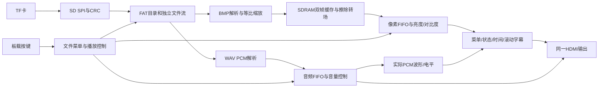

# DMZ FPGA 多媒体展示系统

## 当前范围裁定（2026-10-28，用户最新指示）

用户明确要求：“满足赛题一明确要求即可。”本节优先于下文所有历史计划中“必须非易失启动”“下一步P8固化”等表述。

- 以用户提供的赛题一1.2～1.6为验收依据：指定FPGA平台、明确多媒体应用场景、所有算法/控制/数据处理在FPGA实现、外围无额外处理器，以及核心功能、显示稳定性、基础音频和工程规范性。
- Flash固化、掉电后自动冷启动不是所提供赛题的明确必做项，移出必做范围；不自动推进P8固化或追加完整脱机冷启动验收。当前仅SRAM下载，断电配置丢失，重新上电需下载，不能宣称已固化。
- 下载后媒体读取、解析、播放和板载交互均由FPGA完成；电脑可供电，开发时可用于下载/诊断，不参与运行时算法处理。
- 五项扩展属于可选加分项，当前已集成并实物确认字幕/图层、转场、缩放、参数调节与OSD、实际PCM可视化；保留成果，无需另设新增门槛。应急模式也已实物确认。
- 当前同一主工程作为交付基线。只在出现相关故障或明确新增需求时继续修改和针对性验证，不重复无关基础测试。已有证据表明功能覆盖所提供要求，最终竞赛评定由评委决定。


**最新P7：已集成实际输出PCM波形/左右电平与A11应急模式，程序及用户屏幕/拨码实物确认均通过；证据见docs/p7_validation.json。操作见[可视化与应急说明](docs/P7_VISUAL_EMERGENCY.md)。**

更新：2026-10-28。硬件：大拇指DMZ_EG4S20 / 安路EG4S20BG256，配套综合底板提供TF与HDMI接口。

当前已在实板完成图片/WAV播放、板载按键、文件菜单、OSD、运行时间、滚动字幕、亮度/对比度、等比缩放和水平擦除转场。最新P6验收：7张图片轮播正常，缩放和方向正确，音频连续，相关错误及欠载为零。证据：[P6验证摘要](docs/p6_validation.json)。

## 统一主工程

所有功能在同一主工程中增量集成，下载一份位流即可同时运行。音频可视化和应急模式也已接入这个主工程。

| 入口 | 路径 | 说明 |
|---|---|---|
| TD主工程 | `build_system/dmz_track1.al` | 当前整机工程 |
| 唯一整机顶层 | `rtl/system/dmz_track1_top.sv` | 连接时钟、存储、音画、控制和显示 |
| 当前位流 | `build_system/dmz_track1_Runs/phy_1/dmz_track1.bit` | 整机配置文件 |
| 构建入口 | `scripts/build_system.ps1` | 综合、布局布线、生成位流并检查时序 |
| 下载入口 | `scripts/download_system.ps1` | 下载到FPGA SRAM |
| 控制入口 | `scripts/project.ps1` | 开发阶段构建、下载、诊断与控制 |

`sim/`内的模块测试用于定位问题；历史`build*`目录和`releases/`用于保存早期验证或回退。它们不需要分别下载拼成最终演示，也不是后续功能开发的主入口。

## 目录结构与职责

```text
dmz_track1/
├─ rtl/                         FPGA逻辑源码
│  ├─ system/                   顶层、按键、菜单、媒体控制、OSD及图像参数
│  ├─ media/                    FAT文件服务、BMP缩放、WAV播放与SD仲裁
│  ├─ p3/                       SD SPI接口、双帧缓存与擦除转场
│  ├─ p2/                       SDRAM控制/自检、异步FIFO、状态发送
│  └─ p1/                       HDMI协议、TMDS编码、串行输出与测试音
├─ constraints/                 引脚、电气与时钟约束
├─ build_system/                TD主工程、构建结果和当前整机位流
├─ scripts/                     构建、下载、开发控制与验证脚本
├─ sim/                         模块/集成仿真、存储模型及参考数据
├─ assets/                      素材；p6/为不同尺寸缩放校准BMP
├─ docs/                        结构、需求、操作、进度及验证证据
├─ releases/                    阶段源码/位流/时序/manifest回退归档
├─ README.md                    本说明
└─ README_AI_HANDOFF.md          后续AI接续入口，先读最新章节
```

| 主要源码 | 职责 |
|---|---|
| `rtl/media/dmz_fat_catalog.sv` | 挂载FAT16/32、建立图片/音轨索引、查询文件名 |
| `rtl/media/dmz_fat_stream.sv` | 按簇链提供独立文件字节流，处理反压与取消 |
| `rtl/media/dmz_sd_arbiter.sv` | 共享SD主机，音频缓冲低水位时优先供数 |
| `rtl/media/dmz_bmp_decoder.sv`、`dmz_udiv32.sv` | BMP解析、行缓存、比例计算与等比最近邻缩放 |
| `rtl/media/dmz_wav_decoder.sv`、`dmz_wav_player.sv` | WAV PCM解析、选轨、循环与安全重启 |
| `rtl/p3/dmz_image_framebuffer.sv` | 完整帧提交、读写仲裁和旧/新帧擦除转场 |
| `rtl/p2/dmz_sdram_ctrl.sv`、`dmz_pixel_fifo.sv` | SDRAM时序及跨时钟像素/音频/命令缓冲 |
| `rtl/system/dmz_matrix_keys.sv`、`dmz_board_commands.sv` | 矩阵扫描、消抖、按键映射与开发UART仲裁 |
| `rtl/system/dmz_file_menu.sv`、`dmz_gallery_control.sv`、`dmz_media_control.sv` | 文件选择、图片调度、音源/暂停/音量控制 |
| `rtl/system/dmz_display_control.sv`、`dmz_picture_adjust.sv`、`dmz_osd.sv` | 运行时间、亮度/对比度、菜单/状态及滚动字幕叠加 |
| `rtl/p1/hdmi_core/`、`serializer.sv` | HDMI音视频封装、TMDS编码与EG4串行输出 |

## 整机数据流



图片在后台完整加载，显示读取前台；新图就绪才开始擦除，转场结束才交换帧身份，避免覆盖正在显示的内容。缩放仅需一行源图缓存。音频有独立FIFO并优先获得低水位供数，浏览菜单/加载图片/转场不依赖电脑提供素材。OSD实时叠加，不修改原BMP。

输出固定640×480约59.524Hz。像素时钟25MHz、串行125MHz、SDRAM控制50MHz。板内8MiB SDRAM，两帧RGB565的字节基址为0和0x100000，每帧614400字节。HDMI协议核为MIT复用，PLL/SDRAM使用安路器件资源，详见[来源说明](docs/THIRD_PARTY.md)。

## 当前文件与操作范围

- TF卡使用FAT16/32，根目录8.3短文件名；最多32张BMP、16个WAV，按目录顺序索引。
- BMP：宽1～1920、高1～1080，24/32位未压缩BI_RGB；等比最近邻缩放、居中留边，正/负高度均支持。1920×1080上限已逐像素仿真；实卡验证640×480、960×540、241×481和160×120。
- WAV：PCM、48kHz、16位、小端、双声道。默认首个循环，菜单可选择；手动切换音轨从头播放，允许短暂静音。图片切换保持背景音频连续。
- 默认有声自动轮播，音量0～8档。用户要求保留现有音频增益和扩展屏音量设置。
- KEY0/1切图、KEY2暂停/恢复、KEY3静音、KEY4/5音量减/加、KEY6自动、KEY7重扫、KEY11菜单。
- 菜单内：KEY15/14下一/上一项、KEY13分类、KEY12确认。菜单外：KEY15/14亮度加/减、KEY13对比度循环、KEY12恢复4/4。
- 亮度/对比度默认4/4保持原图。UPTIME是运行时间而非真实时钟；字幕为板内固定标语。更多操作见[按键说明](docs/DMZ_BOARD_CONTROLS.md)。

## 构建、验证与当前状态

在本目录运行：

```powershell
./scripts/project.ps1 -Action Build
./scripts/project.ps1 -Action Download
./scripts/project.ps1 -Action Status
```

开发电脑可用于编译、下载、发送调试命令和读取状态；运行时扫描、解析、控制与音画处理均由FPGA完成。最终验收使用板载操作，不依赖电脑软件，允许电脑仅供电。**目前仅SRAM配置，尚未写入非易失启动介质；掉电后不能直接保留当前配置。**

当前P6构建：15735 LUT、7530寄存器、37 BRAM9K、17 DSP、1 PLL；建立裕量+1.896ns、保持裕量+0.004ns。后续改动必须重新检查资源与时序。最新已验证回退版本为`releases/p7_20261028/`（以P7验证摘要确认状态为准）。

仅运行受改动影响的必要验证，不重复未受影响的一般基础测试。测试入口包括`test_scaler.ps1`、`test_wipe.ps1`、`test_media.ps1`、`test_display.ps1`、`test_osd_menu.ps1`。仿真、构建、实板数据和用户视觉/听音确认分别记录。

后续任务：非易失启动以及完整板端场景验收。P7实际PCM可视化与应急模式的最终实物确认见p7_validation.json。当前尚未完成全部项目目标。

- [固定项目目标](docs/PROJECT_GOALS_LOCKED.md)
- [工程结构、参数与算法详解](docs/ENGINEERING_STRUCTURE.md)
- [当前进度](docs/PROJECT_PROGRESS.md)
- [后续AI接手说明](README_AI_HANDOFF.md)

## 历史P0记录（非当前整机入口）

以下仅保留早期硬件/工具基线证据，旧端口、资源和行为不代表当前版本。

以下为保留的 P0 记录。

## 使用入口
- TD 工程：`build/dmz_p0.al`
- 位流：`build/dmz_p0_Runs/phy_1/dmz_p0.bit`
- 源码：`rtl/dmz_p0_top.v`
- 约束：`constraints/dmz_p0.adc` 和 `dmz_p0.sdc`
- 构建：在工程根目录运行 `powershell -File scripts/build.ps1`。
- 串口验证：SRAM 下载后 SW0 拨上，运行 `powershell -File scripts/test_uart.ps1 -Port COM3`。

## 基线行为
SW0（A9）低电平复位，高电平运行；复位释放经过两级同步。
LED0 每 0.5 秒翻转一次，完整周期 1 秒。LED1～7 显示 SW1～7 的同步输入。
F12 输入经过两级同步后从 D12 回送，作为串口物理链路诊断；这不是 UART 协议解析器。
P0 不驱动 HDMI、SD 卡、矩阵键盘或音频外围，避免未确认扩展连接就输出信号。
LED 引脚与 R-2R DAC 复用，基线运行时 DAC 会有对应电压变化。

## 已核对的主板引脚
依据工作区《大拇指安路EG4S20 - 板卡和开发工具入门.pdf》PDF 第 8、9、13、15、16、24 页。
| 功能 | 引脚 |
|---|---|
| 50MHz 时钟 | R7 |
| SW0 / 本工程 run_n | A9 |
| SW1～7 | A10 B10 A11 A12 B12 A13 A14 |
| LED0～7，高亮 | B14 B15 B16 C15 C16 E13 E16 F16 |
| FPGA UART RX / TX | F12 / D12 |

注意：本工程明确使用 SW0 作为复位输入，不使用 E3 复位键。二者不得混淆。

## 扩展接口核对边界
综合底板说明列出 HDMI 正端：CLK=P1，D0=N1，D1=P4，D2=J3。
这只是资料候选映射，并未加入 P0 约束。进入 P1 前还须确认实际底板版本、负端差分对、IO 电气标准、HPD/DDC 连接和显示设备。
SD 卡需确认实际插槽/模块及 SPI 引脚，不能从 USB 识别结果推断已经连接。
SDRAM 使用芯片封装内 2M×32bit（8 MiB）存储，P2 执行存储测试。

## 已验证结果
- Windows 当前设备：Anlogic AL-Link Mini，状态 OK；CH340 COM3，状态 OK。
- AL-Link 驱动：Anlogic 1.2.3.20，oem285.inf，已签名。
- CH340 驱动：wch.cn 3.9.2024.9，oem215.inf，已签名。
- 工具：D:/ANLU/bin/td_commands_prompt.exe；运行版本 V6.2.168116，与随包 TD 6.2.1 Engineer 168116 对应。
- 综合、布局布线、位流生成成功。
- 50MHz 布线后报告：建立裕量 15.022ns，保持裕量 0.038ns，无违例。
- 逻辑资源：36 LUT，28 普通寄存器；另有 IO 打包寄存器；无 BRAM/DSP/PLL 占用。
- 外部异步输入到第一同步级、异步输出设置时序例外；100% STA coverage 不代表这些外部接口已通过电气验证。
- ChipLinker 检测到 Anlogic USB Cable #0 和 EG4S20BG256。

实物 LED、拨码和扩展接口仍需观察验证；软件构建成功不等同于全部上板验收。

## 上板验证补充
2026-10-25：BitWriter 使用 PROGRAM_SRAM / 5MHz，识别 EG4S20BG256，显示 Downloading succeeded。
未编程 Flash；掉电后 P0 临时配置不会保留。
COM3 / 115200 / 8N1，发送 0x00～0xFF 共256字节，全部原样回传。
证据：docs/download_log.txt 与 docs/uart_test.txt。
剩余人工观察：LED0 每秒完整闪烁一次；SW1～7 对应 LED1～7；SW0 向下复位/向上恢复。
