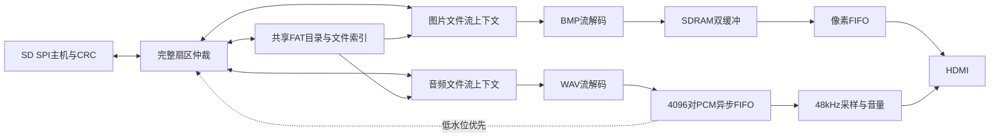

# 共享文件服务与WAV音画播放

**本页为菜单接入前的音画基线记录；最新WAV索引/选轨、OSD和文件菜单见OSD_MENU_STATUS.md，旧“首个WAV”限制以最新说明为准。**

日期：2026-10-28。DMZ_EG4S20 / EG4S20BG256；统一工程 `build_system/dmz_track1.al`，顶层 `dmz_track1_top`。

## 本轮完成及实际结果

- 原来耦合在BMP加载器里的目录扫描、簇链读取和图像解析已分离。图片与音频使用同一挂载结果、同一SD主机，保留两个独立文件读取上下文。
- 扫描根目录最多32张BMP和第一张WAV。图片保持已有切换/轮播，WAV解析、4096对立体声异步FIFO、48kHz输出节拍、音量和HDMI输出已连通。
- SD仲裁按完整扇区切换，包括数据CRC；音频FIFO低于2048对时优先补音频。扇区未通过CRC不会向文件流交付数据。
- 图片换图不重置音频；H/A联动暂停/恢复，K/L仅暂停/恢复音频，暂停时不消耗PCM。静音仅使输出为0，播放时间继续。
- WAV数据结束后重新读取并循环，保留FIFO中尚未播放的数据。此阶段是独立背景音轨，不做图片与同名音轨配对。
- 按用户2026-10-28最新要求，默认启用WAV播放和图片自动轮播，音量8/8，不强制静音。

**实板通过**：TF卡识别4图及1536044字节WAV；联动测试记录已循环32次，WAV错误、SD错误、SDRAM错误、音频欠载和画面欠载均0。切图期间音频样本计数持续增长；H暂停时保持采样播放位置，A恢复后继续；音量7/8→8/8回报正确。结束复核继续播放，仍零欠载。

**用户确认：声音连续，切图画面正常。** 证据：`av_validation_summary.json`、`av_initial_status.json`、`av_playback_status.json`、`av_next_status.json`、`av_previous_status.json`、`av_paused_status.json`、`av_final_status.json`和`av_board_test_log.txt`。

## 数据链路与模块



| 模块 | 职责 |
|---|---|
| `dmz_fat_catalog` | 一次挂载、根目录索引和卷几何；同步输出图片元数据，发现第一张WAV |
| `dmz_fat_stream` | 可复用文件上下文、FAT16/32跨簇流读取、512字节扇区缓存、ready/valid及取消/错误处理 |
| `dmz_sd_arbiter` | 两个客户端请求队列和音频低水位优先；不打断进行中的扇区 |
| `dmz_bmp_decoder` / `dmz_image_player` | 文件字节流到RGB565突发；保持完整帧提交逻辑 |
| `dmz_wav_decoder` / `dmz_wav_player` | RIFF块解析、PCM对、循环文件读取及错误锁存 |
| `dmz_media_storage` | 共享目录、两个文件上下文和SD仲裁的板上集成入口 |

目录结果在启动后固定；换卡或改变文件后执行Reload。文件服务仍是根目录只读子集，不支持exFAT、GPT或递归子目录。

## 使用与格式范围

WAV：PCM=1，48000Hz、16位、双声道、小端，fmt在data前；支持未知块、奇数填充、fmt附加字段和碎片簇链。当前选择根目录中第一张WAV，不是音频播放列表；不支持MP3/AAC、44.1kHz、单声道、24位PCM或浮点WAV。格式错误停止该音轨，图片播放可继续。

BMP：640×480、24/32位未压缩BI_RGB、正/负高度。缩放和转场尚未实现。

```powershell
./scripts/project.ps1 -Action Build
./scripts/project.ps1 -Action Download
./scripts/project.ps1 -Action Status
./scripts/project.ps1 -Action AudioPlay    # W，选择WAV并发声
./scripts/project.ps1 -Action Mute         # M，静音但不暂停时间
./scripts/project.ps1 -Action Tone         # T，切换为测试音
./scripts/project.ps1 -Action Pause        # H，暂停轮播和WAV
./scripts/project.ps1 -Action Auto         # A，恢复轮播和WAV
./scripts/project.ps1 -Action AudioPause   # K，仅暂停音频
./scripts/project.ps1 -Action AudioResume  # L，仅恢复音频
./scripts/project.ps1 -Action VolumeDown   # -，0..8共9档线性增益
./scripts/project.ps1 -Action VolumeUp     # +
```

Next/Previous仅手动切图并暂停自动轮播，不暂停背景音频。切到Tone时WAV FIFO停止消费，切回AudioPlay继续其保留位置；Reload重新初始化所有媒体，从文件开头播放。用户本轮确认已把WAV放入TF卡。PC示例文件位于 `assets/DEMO.WAV`，8秒、左440Hz/右660Hz。

## 必要验证与构建结果

- `scripts/test_media.ps1`：共享FAT/SD并发、3次整帧/921600像素、碎片WAV逐对采样与循环、输入/输出反压；FAT32、FAT16+MBR、32位/负高度BMP；坏WAV、提前结束簇链、无WAV时图片继续。
- `scripts/test_status_uart.ps1`：64/96字节诊断序列及原子快照逐字节核对。
- `scripts/test_system_control.ps1`：串口命令、源切换、音量、联动/独立暂停、注册重载及CDC。
- `scripts/test_av_board.ps1`：上述实卡联动检查；默认结束后保持有声轮播。不重做一般基础长测。
- 最终布线建立裕量+1.504ns、保持+0.004ns，STA覆盖99.99%，包含SDRAM硬宏路径；12041 LUT、6350寄存器、32 BRAM9K、10 DSP、1 PLL。
- 曾修复软件重载组合解码到串行域复位的恢复路径，改为寄存重载输出；诊断发送器改顺序移位，解决96字节动态选择器的局部路由冲突。最终检查通过后才下载。

仅SRAM配置，未写Flash。保持裕量较小，后续增加功能必须重新检查时序，不能沿用本次报告。实板SDRAM读等待1，理想引脚仿真用2，区别仍保留。

## T1ST v4诊断

96字节/24个32位小端字，末字23为前23字XOR。0～14基本沿用v3：13仍为图库信息，14为命令回报；**15不再是校验和**。

| 字 | 内容 |
|---|---|
| 15 | 音频欠载事件数 |
| 16 | 已从音频FIFO消费的立体声对数 |
| 17 | 已解码并写入FIFO的立体声对数 |
| 18 | 已解码完成的WAV循环次数，可能领先于实际扬声器播放位置 |
| 19 | 12:0 FIFO水位，20:13 WAV状态，28:21 WAV错误，29发现WAV |
| 20 | 音频SD读取次数 |
| 21 | WAV文件字节数 |
| 22 | 7:4音量0..8，3音频暂停，2选择WAV，1音频已预填并启动 |
| 23 | XOR校验 |

诊断脚本兼容v2/v3/v4；近期串口为COM9，优先自动查找CH340，不硬编码。硬件证据必须对应当前位流；旧v2长测、v3图库报告仅保留为历史。

## 后续任务

优先字幕与参数OSD（E1/E4），再做擦除/滑动转场、等比缩放（E2/E3）、实际PCM波形/电平与应急模式（E5）。板载按键/开关操作、音轨列表及更精细音画调度仍可完善；完整系统形成后再集中做必要场景验收。
