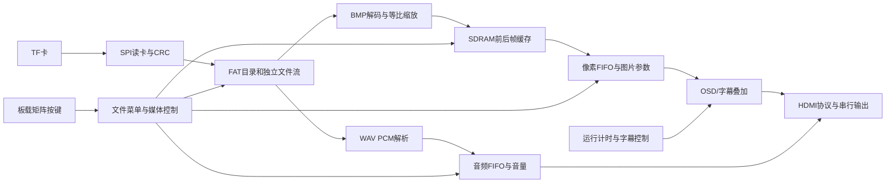

# 工程结构、显示参数与P6构建方案

2026-10-28。硬件为DMZ_EG4S20/EG4S20BG256，配套综合底板提供TF与HDMI。所有运行时文件处理、播放、控制和像素算法均在FPGA；电脑只作开发/调试，也可仅供电。HDMI协议核为MIT复用，PLL/SDRAM使用安路资源，来源见THIRD_PARTY.md。

## 对比度与亮度

亮度给RGB通道整体加偏移；对比度把每个通道围绕128拉伸或压缩。现有算法：clamp(((像素-128)×对比度档位)算术右移2 +128 +(亮度档位-4)×16)，限制到0～255。两参数均0～8档，默认4/4保持原图。对比度4是1倍，8是2倍，0为平灰；高对比度可能裁掉暗部/亮部细节。

| 输入通道值 | 对比度2（0.5倍） | 对比度4（原图） | 对比度8（2倍） |
|---|---|---|---|
| 64 | 96 | 64 | 0 |
| 192 | 160 | 192 | 255（饱和） |

菜单关闭时顶排KEY15/14调亮度，KEY13循环对比度，KEY12恢复默认；菜单打开时保留浏览/分类/确认。OSD不跟随图片参数变暗。音量和增益保持原设置。

## 当前工程分层

| 目录/文件 | 职责 |
|---|---|
| rtl/system/dmz_track1_top.sv | 唯一整机顶层、时钟/复位、模块连接和跨域状态 |
| rtl/media/ | FAT16/32目录索引、文件流、SD仲裁、BMP/WAV解析及播放 |
| rtl/p3/dmz_sd_reader.sv、dmz_spi_byte.sv | TF SPI初始化、扇区只读与CRC |
| rtl/p3/dmz_image_framebuffer.sv | 读优先仲裁、双帧缓存、完整帧提交和擦除进度 |
| rtl/p2/ | SDRAM初始化/刷新/突发、自检、异步FIFO和诊断 |
| rtl/system/dmz_matrix_keys.sv、dmz_board_commands.sv | 矩阵扫描/消抖、按键映射与串口仲裁 |
| rtl/system/dmz_file_menu.sv、dmz_gallery_control.sv、dmz_media_control.sv | 目录浏览、确认提交、轮播、暂停/音源/音量 |
| rtl/system/dmz_display_control.sv、dmz_picture_adjust.sv、dmz_osd.sv | 运行时间、图像参数、OSD与滚动字模 |
| rtl/p1/hdmi_core/、serializer.sv | HDMI音视频包、TMDS编码与器件串行输出 |
| constraints/ | 实板引脚、电气和时钟约束 |
| scripts/、sim/ | 构建/下载、仅相关路径验证、实板诊断 |
| docs/、releases/ | 功能/验收说明、证据、manifest、阶段回退材料 |

主工程build_system/dmz_track1.al，构建scripts/build_system.ps1，下载scripts/download_system.ps1；目前仅SRAM，非易失冷启动待完成。当前输出640×480约59.524Hz；像素25MHz、串行125MHz、SDRAM控制50MHz。板内8MiB SDRAM的两帧RGB565缓存字节基址0和0x100000，每帧614400字节；写入完整后台帧，显示读取前台，转场结束才交换身份。不要将字节地址与控制器32位字地址混用。

音频FIFO低水位时优先读取音频扇区；图片加载及转场不能中断音频。文件查询独立于播放上下文，浏览不加载，确认才选择。4项跨域命令队列保持按键/串口紧邻命令的顺序；状态通过一致快照回传。SW0高运行/低复位，Config不是普通控制键。

## 本阶段：等比缩放

支持范围拟定为宽1～1920、高1～1080的24/32位BI_RGB BMP（实际构建与上板状态见p6_validation.json）。FPGA读取原图，输出完整640×480，保持长宽比并居中黑边；整数尺寸向下取整，极窄图至少1像素。不需要电脑统一图片尺寸。

使用2048×16单行块RAM缓存源图的一行；先按BMP行补齐读取，再最近邻生成所需目标行，放大时复用同一行、缩小时跳过不采样行。正/负高度均方向正确，按文件行序进行最近邻取样。比例初始化采用32周期串行除法，逐像素地址使用误差累加，避免大规模组合除法。完整源像素/补齐读完后才提交最终输出突发，避免损坏后半段文件被当成完整图片。

## 本阶段：图片擦除转场

首次出图直接提交，后续完整新图就绪后开始20阶段水平擦除，每帧推进32像素，约0.35秒。每个突发只读旧图或新图一次，不将视频带宽翻倍。阶段只在消隐切换，后台帧锁住直到结束；swaps/显示图片编号在转场最终完成时更新，加载中的旧图继续显示。属于逐帧、32像素步进的擦除，不是双图透明混合或连续子像素滑动。

## 验证与下一步

- test_scaler.ps1：逐像素验证小图放大、竖图、1080p缩小、行补齐、32位、正负高度、偏移与截断，完整307200像素。
- test_wipe.ps1：20个阶段、旧/新帧地址选择、不能提前交换、后台不能覆盖。Verilator使用--unroll-count 1，避免该版本对循环变量跨进程观察的错误优化。
- test_media.ps1：原生尺寸BMP与WAV共享读卡/反压相关回归。
- 编码/仿真通过不代表构建或上板通过；实际状态统一看docs/p6_validation.json。后续为实际PCM波形/电平、应急模式，最后非易失启动和完整板端场景验收。
