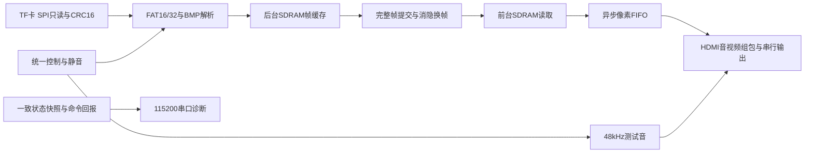

# 统一工程之后的赛道一实施路线

日期：2026-10-27。应用目标：校园信息展示与应急广播终端；日常图片/音频播放、字幕信息展示，按键进入应急图文与提示音模式。运行时所有扫描、解析、调度、显示和音频处理在FPGA内实现。

## 执行优先级（用户最新指示）

以实现最终播放系统及五项扩展为优先。只保留直接影响功能正确性、稳定输出或当前故障定位的必要验证；不因未完成一般基础检查而阻塞功能开发，不重复已通过且未受本次改动影响的测试。

- 现有统一工程直接作为后续开发基线；实体拨码、额外卡型、长时间听音等记录保留，但在没有相关故障时不作为M1/M2的前置条件。
- 每次只验证受改动影响的数据路径；涉及读卡、帧提交、时钟、音频连续供数时，保留对应必要检查。
- 当前执行顺序为文件索引/多图切换/轮播→WAV与音画调度→字幕/OSD→转场/缩放→音频可视化与应急模式。
- 完整系统形成后，按实际演示场景集中进行必要的连续运行和异常恢复验证；不在每个阶段重复固定30分钟或2小时的长测。

## 开发顺序和验收门槛

| 里程碑 | 工作内容 | 可以演示的结果 | 通过条件 |
|---|---|---|---|
| M0 基础统一工程 | 合并已验证存储、首图、HDMI和控制；CRC、重复加载、诊断、长测 | 一份工程显示实卡图片，按命令开关声音，启动自检可观察 | 已满足继续开发条件；实板首图/音频、三次媒体重载及30分钟状态监测已通过；其余一般检查不阻塞M1/M2 |
| M1 文件服务与图片播放 | 从当前BMP加载器提取共享FAT/文件流接口；建立有限图片索引、跨簇读、上一张/下一张、暂停、定时轮播 | 无需重新下载即可选择/自动切图；坏图跳过并保留正常前台 | 三张以上不同内容图片；首尾循环、暂停/恢复、碎片文件、读失败不提交半帧；切图欠载0 |
| M2 WAV及音画调度 | RIFF/WAVE块扫描、PCM解码、音频FIFO、读卡仲裁、播放时间基准、静音/音量/暂停 | TF卡图片与WAV经同一HDMI同时播放，图片加载不断音 | 初版48kHz/16位/双声道PCM；fmt/data未知块和奇数填充处理；截断/非法格式拒绝；持续音频FIFO欠载0；暂停与切换行为一致 |
| M3 字幕与参数OSD | 字库ROM、图层、运行时间、滚动标语、亮度/对比度、音量与状态提示 | 轮播带字幕，参数实时可见 | 图层像素/延迟对齐、滚动平滑、饱和无溢出，新增流水线后同步信号与坐标一致；完成E1/E4 |
| M4 连续转场 | 基于预加载双帧，先擦除/滑动，再评估淡入淡出 | 图片切换连续、有清楚可见的过渡 | 预加载完成后才转场；逐像素/帧边界检查；无撕裂黑闪或持续欠载；完成E2 |
| M5 自适应缩放 | BMP任意行补齐、输入尺寸校验、最近邻等比缩放和居中留边；之后评估双线性 | 不同尺寸/长宽比图片都能显示 | 建议首期1～1920×1080、24/32位BI_RGB，最终上限以时序和资源实测确定；横竖图、放大/缩小、边界像素与参考模型一致；完成E3 |
| M6 音频可视化与场景 | 从实际输出PCM抽取波形、左右电平与峰值；应急优先级/提示音；有余量再做FFT | 音量/音轨变化会改变叠加的波形，按键切入应急信息 | 不用预置动画假冒音频数据；可视化不阻塞音频；应急进入/退出和静音规则明确；完成E5和应用场景 |
| M7 稳定性与交付 | 按实际演示场景进行全功能连续运行、必要的异常恢复、运行说明和演示流程 | 可独立操作和重复演示的完整终端 | HDMI输出、音频、切图/转场持续无欠载；与目标相关的异常可恢复；模块来源明确、工程可重建、测试报告完整；测试范围/时长按实际风险确定 |

每一步修改统一顶层及共享模块；保留上一个已验证位流作为回退，不再依赖多个演示工程拼接。尚未通过的能力不标记“已完成”。

与原P阶段对应：M0=P0～P3基础合并，M1补齐P3播放控制，M2=P4，M3=P5，M4/M5=P6，M6=P7，M7=P8。M2的WAV解析器已提前完成独立RTL和21项离线测试，但文件服务、音频FIFO/调度和上板播放仍未接入；详见 `WAV_decoder_status.md`。

最新进展：M1的32项图片索引、上一张/下一张、轮播/暂停及坏图保留前台已实现，实卡4图循环/命令通过，用户确认切图画面正常。见 `GALLERY_STATUS.md`。共享FAT文件流尚未抽取，下一步以此为起点接入WAV；无需再重做图库基础功能或一般基础长测。后续AI入口为根目录 `README_AI_HANDOFF.md`。

## 当前统一数据路径

后续把FS演进为共享文件服务，再将WAV解码/音频FIFO接入同一HDMI，把图层、参数处理、缩放与转场接入视频流水线。PC脚本用于构建和测试，扫描/解析/播放不依赖PC执行算法。

## 资源与带宽安排

- 固定640×480输出先完成完整功能；720p仅在带宽、资源、接收器和时序验证后提升。赛题原文未强制720p。
- 两块RGB565帧缓存各614400字节，地址沿用0x000000和0x100000；8MiB剩余空间供后续预取/音频缓存使用。
- 当前图库主工程7575 LUT、4556普通寄存器、13 BRAM9K、6 DSP、1 PLL；建立裕量+0.988ns、保持+0.032ns。剩余资源是预算，后续综合结果才决定可实现范围。
- WAV流比图片后台加载更需要连续供数；SD调度按音频FIFO低水位优先，图片在空闲扇区窗口读取。复用单个SD主机，不让两个模块同时驱动SPI。
- 文件层保存图片和音频各自的簇/文件偏移上下文；切换文件流时不重新挂载整卷。先完成共享FAT服务，再接WAV，避免复制两套互不协调的读卡状态机。
- 显示SDRAM读取优先于后台图像写入，刷新仍有截止时间。音频小FIFO可先放BRAM，必要时增加SDRAM环形缓存。
- 擦除/滑动优先，因为每个输出像素通常只选一幅图。双图淡入淡出需要双路像素带宽，先测吞吐，再决定预取缓存或降低转场负载。
- 缩放采用定点坐标/误差累加及行缓存，运行时全部由FPGA执行；使用离线仿真生成参考结果仅用于测试。
- 字幕显示“运行时间”，没有RTC时不冒充真实日期时间。中文字模作为资源存储，图层组合和滚动控制由FPGA实现。

## 四项基础评分要求与交付证据

| 基础要求 | 最终实现 | 必须保存的证据 |
|---|---|---|
| 核心功能完整性 | 实卡资源管理、图片播放、音频、交互、应用模式 | 功能矩阵、完整演示流程、文件格式限制和异常结果 |
| 显示稳定与鲁棒性 | 刷新、FIFO、双缓冲、完整帧提交、超时/CRC/文件错误处理 | 逐像素仿真、时序、实板欠载0、异常恢复及长测 |
| 基础音频输出 | HDMI测试音并演进到WAV PCM | 包/时钟验证、实际听音、静音/恢复、连续播放及FIFO诊断 |
| 工程规范性 | 唯一顶层/构建入口、分层接口、约束、来源署名 | 可重建脚本、SHA256清单、仿真/板级报告、操作说明 |

五项扩展分别由M3～M6覆盖。优先做稳定且能现场看到效果的功能，再提高算法复杂度；FFT、双线性和淡入淡出属于进阶，不挤占基本播放和稳定性的验收。

## 需要实物配合的检查

本轮已由用户确认HDMI拔插后自动恢复、图片正常。物理SW0复位、断电重新下载、不同真实TF卡、无卡/坏文件启动、持续听音等一般检查，按用户最新要求不再单独补测或阻塞功能推进；只有影响最终演示或出现对应问题时才安排。已有证据范围保持不变，不把未测项目标记为通过。
