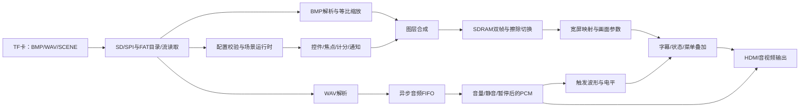

# 主分支最终功能移植与离线验证技术报告

日期：2026-11-04。目标平台：DMZ / EG4S20BG256 单板。移植来源：main 最终提交 `b393683190e6d10618284aaaa0a2d06a756552bb`（Final）；目标：zyr，保留整理后的工程结构。本报告供技术文档“系统组成及功能说明”“完成情况及性能参数”等章节引用，不修改用户维护的 Word 文档。

## 1. 本轮结论与证据边界

**功能移植已完成，12项RTL仿真全部通过，最终源码已完成综合、布局、布线和位流生成；尚未通过严格正式发布检查。** 本次setup为+0.106ns、hold为+0.092ns。STA覆盖率99.99%，两路PLL反馈局部布线提示仍需审查，因此候选保留在TD Runs，未覆盖release/current的旧正式位流。重新读取main既有布线数据库后，复现了相同99.99%覆盖和两路USR-6135提示；这些不是本次目录整理新增的问题。

本轮没有打开串口、下载 SRAM、烧写 Flash 或操作实机。main 中的历史板测记录仅作来源参考，不能作为本分支的新板测结果。软件预览、RTL 仿真和布局布线分别证明不同内容，不能互相替代。

## 2. 项目定位与需求对应

系统定位为**基于 FPGA 的可配置校园交互多媒体终端**，以“声音与音色”课件展示图文、讲解、波形观察、答题和成绩。普通/优先通知作为同一终端的公共信息插播能力，退出后返回课程上下文，不强行把通知内容编成声音课程。

运行时由 FPGA 完成 TF 访问、格式解析、缩放、存储调度、图层合成、控制和 HDMI 音视频输出。电脑负责开发、资源制作、打包及可选诊断，不参与正常播放中的算法处理；系统不引入额外处理器。

| 赛题条款 | 对应实现 | 适合展示的环节 |
|---|---|---|
| 1.3 明确应用与 FPGA 自主处理 | 配置化多媒体终端、硬件媒体管线与场景状态机 | 整场演示，解释资源到 HDMI 的数据流 |
| 1.5 基础(1)核心功能完整性 | TF 资源、图文讲解、音源选择、题目提交、成绩、通知返回 | 从开机展示到答题成绩的闭环 |
| 1.5 基础(2)稳定与鲁棒 | CRC/格式/边界检查、双帧切换、FIFO、刷新和异常状态 | 离线结果加后续连续运行/异常素材板测 |
| 1.5 基础(3)基础音频 | HDMI 嵌入 PCM 讲解和三种观察样本 | 讲解、纯音/钢琴/人声切换 |
| 1.5 基础(4)工程规范 | 单工程、唯一输入清单、按职责目录、可重复打包与验证清单 | 提交源码、构建入口与证据 |
| 1.4 扩展(1)图层和字幕 | 控件/焦点/答案/分数叠加、右侧中文状态栏、顶部中文滚动标语 | 全过程和答题页 |
| 1.4 扩展(2)轮播和转场 | 配置驱动自动演示、KEY2 暂停/继续、10 步擦除切换 | 实验图和课程自动推进 |
| 1.4 扩展(3)缩放适配 | 不同尺寸 BMP 经 FPGA 等比最近邻缩放、居中留黑边 | 横图、竖图和小图三页 |
| 1.4 扩展(4)参数和 OSD | 音量/亮度/对比度调整、常驻数值、变化高亮及方向提示 | 调节参数并恢复默认 |
| 1.4 扩展(5)音频可视化 | 实际播放 PCM 波形、双声道电平/峰值、上升过零触发 | 声音观察页 |

条款根据赛题 PDF 第14～15页的选题一原文核对。五项扩展均有实现入口；“显示稳定”“现场效果良好”等结论仍须以本分支实物验收补充，不能只凭功能数量认定。波形已满足可视化方向，未实现 FFT 频谱。

## 3. 工程结构与移植范围

唯一工程是[dmz_track1.al](../project/td/dmz_track1.al)，输入来自[sources.f](../project/td/sources.f)，包含57个有效 RTL 和2个约束。源码按职责分为 platform、storage、control、video、audio、common、hdmi、top；素材只放 assets，构建工作库只放 build 或 TD Runs。

| 本轮迁入内容 | 主要文件/位置 | 实现作用 |
|---|---|---|
| 完整触发状态绘图 | `rtl/video/dmz_trigger_button.sv`、顶层 | 补回之前 main 缺失的绘图模块；展示触发及自动演示状态 |
| 顶部中文滚动字幕 | `rtl/video/dmz_top_ticker.sv`、字模 JSON | 独立输出坐标绘制，循环移动并与视频流水对齐 |
| 自动演示 | `dmz_scene_runtime`、`dmz_ui_keys`、`dmz_media_pipeline` | 配置可选自动跳页，默认开启，KEY2暂停/恢复 |
| 合成时序优化 | `dmz_page_compositor` | 先寄存像素写掩码/数据，排空最后一次写入后才提交突发 |
| SDRAM输出优化 | `dmz_sdram_ctrl` | 寄存DQ写使能，保持原总线周期 |
| 内存资源调整 | `dmz_pixel_fifo`、BMP解码器、顶层 | 音频FIFO和行缓存按main映射BRAM32K，保留地址/数据编码 |
| 波形与提示音优化 | `dmz_audio_visual`、`dmz_scene_control` | 拆开电平判定组合路径，寄存警示相位 |
| 最终课件 | `assets/course.json`、media/ui | 19页、47控件、55资源，增加三种尺寸实验图 |

原有宽屏、双 PLL、三拍画面参数处理、中文常驻面板、峰形插值等均保留。保留 zyr 的 `dmz_clocking`、`dmz_media_pipeline` 名称，对应 main 的 `dmz_p2_pll`、`dmz_media_storage`，不新增空封装。

对照结果：57个有效模块均能对应 main 当前文件，且 main 最终 `scaling_demo_20261103/source.zip` 中的有效源码与 main HEAD 一致。仅有以下本地等价修改：

1. 长度对齐表达式中的 `31` 写为 `32'd31`，明确拼接操作数位宽，不改变32位对齐运算。
2. BMP 高度、宽度低11位和位深判断的组合表达式显式引用相同头字节，避免事件仿真器遗漏函数内部数组的敏感依赖；缩放算法和输出位宽不变。
3. 路径、已有模块名、字库生成注释/标记按当前结构适配。

未恢复 main 中未被顶层使用的 `dmz_board_commands`、旧 `dmz_bmp_loader`、历史工程、构建数据库、阶段素材包、旧测试框架及嵌套第三方仓库。它们不承担当前主工程的实例化功能。

## 4. 硬件组成、时钟与存储

| 项目 | 当前设计参数 |
|---|---|
| 核心器件 | EG4S20BG256，单板实现 |
| 输入时钟 | 50MHz |
| 存储域 | 50MHz；SDRAM外部时钟采用相位偏移 |
| 视频像素/串行域 | 75MHz / 375MHz，双PLL |
| HDMI活动画面 | 1280×720 |
| 总行/总帧计数 | 1650×750，目标帧率75,000,000/(1650×750)≈60.606Hz |
| 内部课件 | 640×480、RGB565；中央映射到960×720，左右各160像素 |
| SDRAM | 2M×32bit，共8MiB；32bit数据、BL8突发 |
| 双帧基址 | 字节地址0x000000、0x100000；单帧614,400字节 |
| 配置区 | 字节地址0x200000～0x2FFFFF |
| 音频格式 | PCM WAV，48kHz、16bit、双声道 |
| 音频FIFO | 2048对立体声样本，理想容量约42.67ms |
| 资源容量 | 最多32 BMP、16 WAV；场景64资源、32页、128控件，每页最多8控件 |

75MHz宽屏时序与标准74.25MHz/60Hz有区别，技术文档宜写“1280×720、约60.606Hz”，不能写精确标准720p60。TD报告中的75.002/375.094MHz等数值来自报告周期显示精度，不应误当成更换了PLL参数。不同显示设备的实际兼容性仍需实测。

输入含矩阵按键、运行/复位开关、通知与可视化开关、可选UART；输出含HDMI、按键行扫描、状态LED与UART。引脚约束沿用main的当前板卡约束，未更换板型或增加接口。



## 5. 关键算法与控制方法

### 5.1 图片读取和等比缩放

FPGA读取BMP文件头，检查签名、DIB、尺寸、24/32位像素格式、未压缩标志、偏移和文件长度。支持正/负高度，分别处理底向上与顶向下行序以及行末4字节对齐填充。

缩放目标首先固定在内部640×480画布。对于输入W×H：若W×480≥H×640，则输出宽640、高floor(H×640/W)；否则输出高480、宽floor(W×480/H)。随后居中留黑边。采用一行缓存和最近邻取样，比例只在初始化阶段用迭代除法求取，运行中以误差累加推进采样坐标，不需要全幅源图缓存或组合可变除法。

| 实验资源 | TF原始大小 | FPGA内部缩放结果 | 演示意义 |
|---|---|---|---|
| WIDE01.BMP | 1280×720 | 640×360，上下各60黑边 | 横向缩小、比例保持 |
| TALL01.BMP | 360×640 | 270×480，左右各185黑边 | 竖向缩小、居中适配 |
| SMALL01.BMP | 320×240 | 640×480 | 小图放大 |

电脑打包时保留原始BMP字节，不提前统一缩到640×480。之后内部画布再经宽屏映射显示为中央960×720；这两个阶段应分开描述。当前不支持任意指定子矩形缩放，也没有实现双线性插值。

### 5.2 帧缓存、转场和宽屏供数

图片写入后帧，前帧供视频扫描；换帧在帧边界处理，避免一张尚未写完整的新图直接进入显示。切换使用逐步扩大覆盖区域的擦除效果，每次推进32个打包字，共10步覆盖一行320个字。10步不是“整个切页只需10帧”的实测承诺，TF读取、解析、合成和提交也占用时间。

宽屏把640×480课件等比放大到960×720，三个输出像素消费一对打包像素。行重复、预取与FIFO配合供数，不为1280×720另开完整帧缓存。读优先仲裁与刷新逻辑保证显示侧优先取得数据；真实TF最坏延迟下的音频余量仍需上板评估。

### 5.3 图层、字幕和画面参数

UI像素采用A1R5G5B5格式，透明位决定是否覆盖背景；按钮、中文标签、焦点、所选答案和计分由配置和运行状态控制。图层合成采用寄存后的像素写掩码，最后一次写入落入突发缓冲后才允许下游接收，避免最后像素被提前提交。

顶部字幕使用固定中文字模ROM，文字为“本项目是安路科技赛道一项目，内容为校园交互终端演示，课件仅作演示使用，实际应用场景可更换调整”。横向循环2048物理像素，文字46字、尾随18个全角空格；每两帧推进2个物理像素，约60.6像素/秒。顶部色带1280×40，文字区域在垂直4～35像素，覆盖优先级高于下层画面。

右侧面板持续呈现播放/暂停/静音/结束/加载/无音频/错误等状态及音量、亮度、对比度，参数变化后约2秒高亮并显示方向。左侧状态图形补齐触发及自动演示提示。亮度/对比度使用三拍流水，与视频和叠加控制延迟对齐；默认值4/4，音量范围0～8。状态栏是实时绘制，课程背景中的正文仍属于静态图片。

### 5.4 音频、播放完成和实际波形

WAV解码后通过2048对异步FIFO跨域，经过音量、静音及暂停控制后送HDMI。波形取自同一实际输出PCM，因而静音和音量变化能在波形/电平中体现，不用独立动画冒充音频数据。播放完成按样本消费而非仅按文件读取结束判断，并用音轨票据避免旧轨完成信号误触发新页面自动跳转。

观察波形对48kHz样本作8倍抽取，得到约6kHz显示采样，128点对应约21.33ms。保留12位幅值，相邻采样点插值成连续线段；采集与显示双页切换，完成的采集页在垂直消隐边界提交，不阻塞音频。

触发先等待左声道小于-128，再在上升过零处开始采集；4096个音频样本仍无合适触发时自动采集，约85.33ms，防止静音/DC输入使显示停止。KEY4在观察页、无通知/菜单/加载时切换触发，其他上下文保留退出插播功能。没有频率测量精度、FFT或音频延迟实测数据，不应据此填写这些指标。

### 5.5 配置交互、自动演示与通知

SCENE.BIN包含资源、页、控件表及嵌入式UI图集，带版本、计数、长度和CRC。运行时检查资源/页面/控件边界并解析文件名，页面流程不硬编码进一套独立软件播放器。当前配置为19页、47控件、55资源；其中19 BMP、7 WAV、29 UI图集资源。

默认自动流程是：

`WIDE01 → TALL01 → SMALL01 → WAIT01 → WAIT02 → COURSE → LESSON01 → LESSON02 → LESSON03 → OBSERVE → QUIZ01`

前三页各7秒、两张待机页各4秒、入口2秒，三段讲解及观察页由有效音轨完成信号推进。到题目停止，答案必须人工选择和提交；解释页4秒后继续，最终进入成绩页。KEY2开始/暂停/恢复自动跳页，**不暂停当前讲解音频**；KEY15返回第一张实验图并恢复默认自动状态。菜单、通知、加载及轨道切换中抑制自动跳页，人工事件优先。

普通/优先通知具有优先级和上下文保存，退出后返回原页；物理优先通知必须释放开关。焦点和答案分别显示，提交负责计分，重复提交不能重复加分。配置化允许在容量/动作集合内更换页面、素材及跳转，不等于可执行任意脚本或动态下载RTL算法。

## 6. 素材与主分支效果对齐

本轮将main最终资源迁入现有assets/media与assets/ui，仅修改主机端source路径，保留资源顺序、板端文件名、动作和记录语义。打包结果中27个运行文件与main最终包逐字节一致；SCENE.BIN为536,256字节，SHA256：

`837fece0048ffaa0726bd6c5ce6cba140bf90dfac75396ac7f4fdab07859806c`

因此图片内容、声音样本、UI量化像素、页面顺序和自动配置均不是本地重新设计的近似版本。PACKAGE.json中的来源路径按zyr目录更新，不要求它与main主机端清单逐字节相同。UI已嵌入SCENE，不交付重复的Uxxx.BIN。现有量化PNG不能冒充原始矢量设计稿。

## 7. 离线验证结果

| 检查 | 结果 | 核对内容 |
|---|---|---|
| audio_completion | 通过 | 暂停/消费计数、有效音轨完成与票据处理 |
| ui_controller | 通过 | 焦点/答题/提交计分及交互控制 |
| fifo | 通过 | 2048对容量、异步时钟、满空、随机停顿、多次回绕与复位；BRAM32分支 |
| ui_keys | 通过 | 16键映射、课件/菜单路由、UART共享事件及复位 |
| trigger | 通过 | 上升过零、重复相位、静音超时与自由采集切换 |
| ticker | 通过 | 完整栅格、边缘/消隐、帧节拍、尾部空格与循环回绕 |
| scaler_wide | 通过 | 1280×720/24位：307200像素、黑边、源流停顿与ACK背压 |
| scaler_tall | 通过 | 360×640/24位：307200像素，竖图适配 |
| scaler_small | 通过 | 320×240/24位：307200像素，小图放大 |
| scaler_rgba_top | 通过 | 321×241/32位、顶向下：307200像素、行对齐 |
| widescreen | 通过 | 两帧1382400课件像素、460800打包对、SDRAM刷新/FIFO无欠读；2344个音频采样 |
| course | 通过 | 真实SCENE的CRC/加载/资源解析；自动到第一题、KEY2、菜单、旧票据、Home |

缩放检查使用可计算参考像素的合成BMP流，尺寸对应实际演示素材，并额外覆盖32位/正向行序；不将它称作实际素材照片逐像素板测。实际素材与main一致由资源字节比较证明。课程仿真使用本轮重新打包的真实SCENE，经加载器/CRC/配置写入和SDRAM行为模型送入运行时，验证自动链到第一题及Home恢复；不会模拟真实TF读卡电气特性。

两帧宽屏检查使用独立SDRAM命令行为模型，包含刷新与突发时序检查。它验证的是数字协议/供数和采样节拍，不包含PCB信号完整性、显示器接收、电气建立保持、扬声器观感或完整TMDS接收解码。中文侧栏、转场视觉、实际通知全过程和三题完整现场流程仍需上板复核。

当前仿真直接编译生产RTL，无源码转换层、C++后端或历史顶层并行比较链。ModelSim10.3c对main的部分表达式出现声明顺序错误/编译器内部错误，本轮采用本机Icarus Verilog；发现并处理的是工具可移植性问题，未据此改写媒体算法。

## 8. 综合、布局布线与性能对比

工具：Tang Dynasty 6.2.168116；目标EG4S20BG256。物理参数对齐main最终工程：seed11、单线程、place effort high、opt_timing high、post_place_opt high、place fix_hold on、route effort routability、swap_pin off。沿用当前流程的布线后hold修复及原有SDC，不新增false path或放宽时钟周期。

| 指标 | main最终记录/数据库 | zyr本次最终构建 | 差值 |
|---|---:|---:|---:|
| LUT | 17190 | 16900 | -290 |
| 寄存器 | 9368 | 9575 | +207 |
| BRAM9K | 54 | 54 | +0 |
| BRAM32K | 3 | 3 | +0 |
| DSP | 21 | 21 | +0 |
| PLL | 2 | 2 | +0 |
| Setup最差余量(ns) | 0.102 | 0.106 | +0.004 |
| Hold最差余量(ns) | 0.075 | 0.092 | +0.017 |
| STA覆盖率(%) | 99.99 | 99.99 | +0.000 |

LUT占用86.22%，寄存器48.85%，BRAM9K84.38%，BRAM32K18.75%，DSP72.41%，PLL50%。LUT减少约1.69%，寄存器增加约2.21%；没有增加额外封装或新增业务功能来解释这部分差值。源码位级等价写法、名称和后续优化映射可能改变打包/复制结果，未做多轮试验，不能将207个寄存器的精确归因写成已证实结论。两项时序余量均正且略高于main，未观察到目标频率下降。

资源数是本次工具实现结果；LUT减少不自动代表速度提高，寄存器增加也不自动代表功能变多。setup/hold是满足目标周期的最差余量，不是屏幕帧率的额外增量。只要时钟/总计数不变，目标输出分辨率和帧率不随余量变化。若要声明架构性能优于main，仍需同条件对照和更完整指标，本报告不作这种推论。

### 发布门槛与尚未解决的时序问题

- **覆盖率99.99%**：main与zyr均如此。check_timing报告无未驱动时钟、无效约束或组合环，但仍列出宏/映射哑节点、未显式设置延迟的外设端口及硬宏输入延迟检查项。尚未建立这些项目与未覆盖0.01%的精确对应关系，不能宣称全部时序已覆盖，也未添加例外掩盖它。
- **USR-6135**：两路PLL反馈网络使用局部布线，工具提示补偿延迟不可预测。在main既有路由数据库上执行同样检查也复现两条提示，确认是共同基线问题。数字仿真和正setup/hold不能保证该补偿风险已经消除，后续应依据安路器件/PLL指导审查反馈和时钟布线。
- **其他工具提示**：包含SDRAM硬宏位置合法化PHY-7002、局部时钟路由PHY-5079，以及部分存储初值/器件优化能力相关警告。未将“产生位流”改写为“无warning”。

严格构建入口仍要求100%覆盖及未审查critical warning为零，因此本次脚本最终以“候选已构建、未发布”退出。旧正式bit/manifest/timing保持原样，当前源码的下载哈希检查会拒绝它们。候选文件路径为`project/td/dmz_track1_Runs/phy_1/dmz_track1.bit`，其构建清单在`build/reports/candidate_manifest.json`，精简副本见[候选清单](../release/current/candidate_manifest.json)。

候选位流SHA256：`96e139209564eccae2c314009241d064645423cf3cbfb802f6f7caeda5bec533`。本报告明确保留两个未解决项，不通过降低发布门槛或反复换seed把它们标为已解决。

本轮前期在仿真可移植性问题收敛前中止过两次未完成的构建，不把其中数据库当作最终结果；表中仅采用固定最终源码后的完整构建。没有做多seed搜索，也没有反复改变功能以追逐更好时序。最终源码、工程、流程、位流和测试摘要均由SHA256关联。

## 9. 技术文档可填写的成果与创新

可填写的已实现成果包括：单FPGA配置化音视频管线；有限资源下的等比适配、双帧与宽屏供数；真实PCM上升过零触发和插值波形；配置驱动课程/题目/计分/优先插播；实时参数与中文常驻状态/字幕；清晰的单工程与可重复资源制作流程。

其中HDMI协议模块改编自hdl-util/hdmi（MIT），PLL及SDRAM硬宏使用安路原语，应保留来源，不列为全部自主研发。自行编写的存储/媒体/交互/可视化逻辑和系统集成可以据实说明。电脑离线生成字模和素材属于开发准备，不能写为FPGA运行时通过电脑预处理。

尚不能填写为本轮已实测的指标：长时间无故障运行时长、真实切页延迟/音画同步误差、实际TF最坏读延迟、声音失真/信噪比、不同显示器兼容率、Flash断电启动、功耗和现场观看/听测结论。main板测记录引用时须同时注明分支、位流和原始证据范围。

## 10. 复现和后续验收

```powershell
# 从仓库根目录运行，填入本机安装路径
./scripts/project.ps1 -Action Package -Python <Python可执行文件>
./scripts/project.ps1 -Action Test -IcarusRoot <Icarus安装目录> -Python <Python可执行文件>
./scripts/project.ps1 -Action Build -TdRoot <TD安装目录>
```

TF打包输出位于release/current/tf，运行需要19个BMP、7个WAV、SCENE.BIN；PACKAGE.json为电脑端清单。更新生成目录遇到旧内容冲突时，先确认目录仅含生成物再清空重打包。

后续实板验收建议按“启动/错误状态→三图缩放和字幕→KEY2与菜单保护→讲解和三音源→触发与参数→三题计分→通知插播/返回→连续运行”执行；Flash固化、断电启动另作明确任务。本轮没有执行以上实机步骤，也没有提交、推送或合并分支。

证据入口：[验证摘要](../release/current/verification.json)、[验证说明](VALIDATION.md)、[当前交付状态](../release/current/README.md)。详细构建日志和测试工作库位于build及TD Runs，属于可删除生成物；正式报告只保留当前结论和必要来源，不复制历史测试归档。
